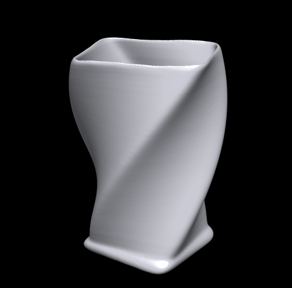
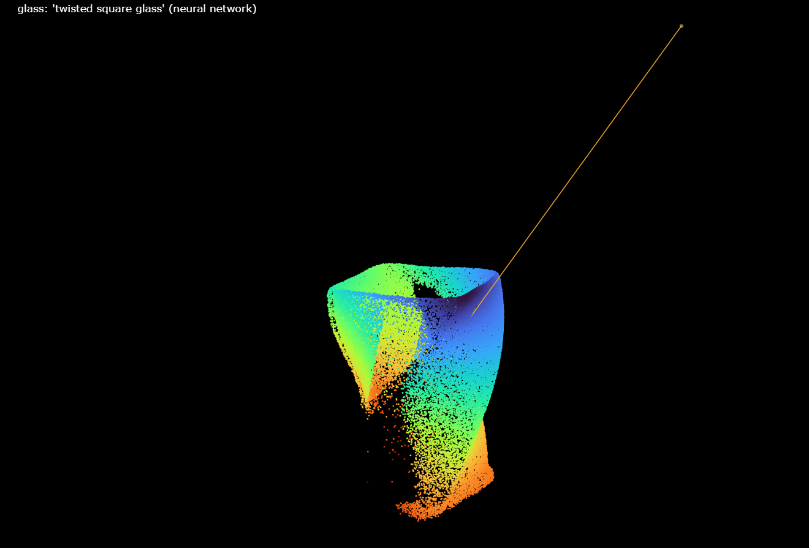
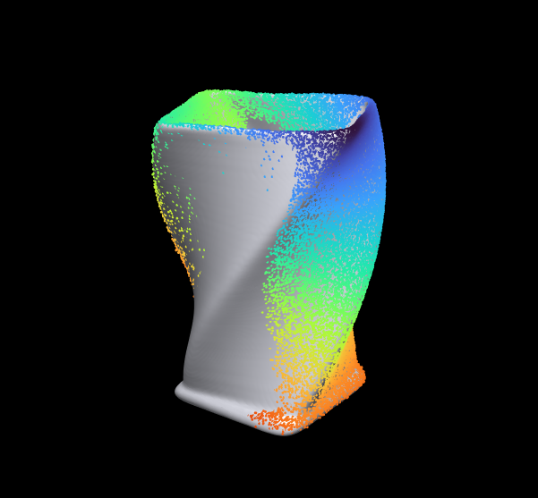
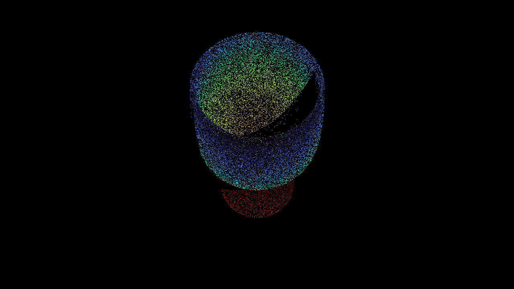
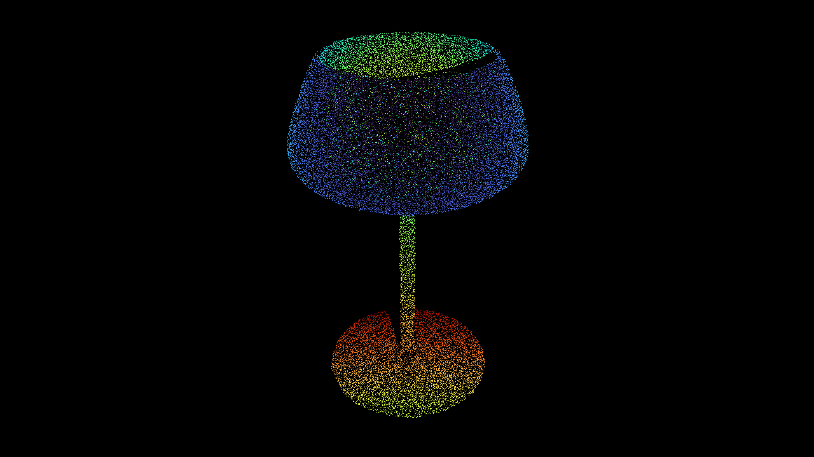
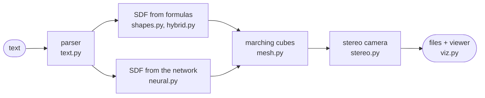
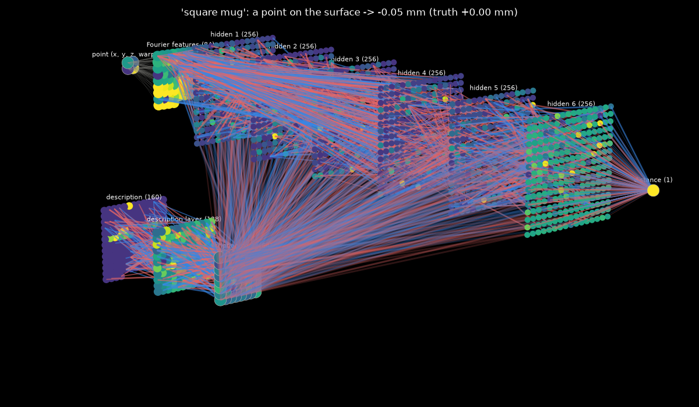
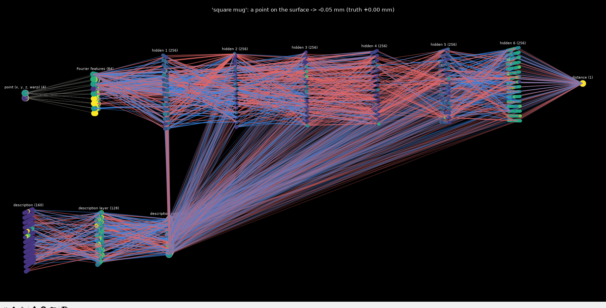

<h1 align="center">KitchGen</h1>

<p align="center">
  <b>Text → a 3D kitchen object → the point cloud a stereo depth camera would see.</b>
</p>

<p align="center">
  
  
  
</p>

<table align="center">
  <tr>
    <td align="center"><br><sub>mesh</sub></td>
    <td align="center"><br><sub>what the camera saw (orange line = camera)</sub></td>
    <td align="center"><br><sub>both together</sub></td>
  </tr>
</table>

<p align="center"><code>python generate.py "twisted square glass" --neural</code></p>

---

KitchGen turns a plain English description into a mesh of a kitchen object, then photographs it with
a simulated stereo depth camera. You get the clean, complete shape and the noisy, one-sided point cloud a real
sensor would give you.

**Its main use is training data for point cloud completion.** That means teaching a network to work out an
object's whole shape from the one side a camera sees, which a robot needs before it can grab a mug it has never
seen. Collecting such data for real means 3D-scanning every object and lining each scan up with the camera.
KitchGen makes as many pairs as you like, a few seconds each, with the exact shape and the exact camera pose.
**[Make a dataset →](#make-a-shape-completion-dataset)**

- **12 objects:** fork, spoon, knife, ladle, spatula, mug, cup (optionally on a saucer), bowl, plate, glass, wine glass, frying pan
- **Any outline:** square, oval, hexagonal, fluted, twisted, barrel-shaped containers
- **Crosses:** a mug-bowl hybrid, "70% mug 30% wine glass", a spork
- **A realistic camera:** modelled on an Intel RealSense D435, with stereo shadows, depth noise, holes, flying pixels and material effects (metal glare, see-through glass)
- **Two shape engines:** exact formulas, or a trained neural network that has learned all 12 objects

## Quick start

```
git clone https://github.com/Sulimowski/Kitch_Gen.git
cd Kitch_Gen
pip install torch --index-url https://download.pytorch.org/whl/cu128
pip install -r requirements.txt

python generate.py "fork with 3 prongs and a long handle"
```

A browser tab opens with the mesh, the point cloud and the camera (drag to rotate; click a legend entry to hide
or show a layer). The trained network is included in `models/`, so `--neural` works straight away.

Every run saves its results to `outputs/<object>_<time>/`:

| file | what it is |
|---|---|
| `mesh.obj` | the object's mesh |
| `cloud.ply` | the stereo point cloud in object coordinates (lines up with the mesh) |
| `cloud_camera.ply` | the same cloud in camera coordinates, the way a real sensor hands it to you |
| `depth.png` | a coloured picture of the depth frame |
| `params.json` | what was understood from the text, every shape parameter, the camera pose and intrinsics |
| `view.html` | the 3D viewer |

## Make a shape completion dataset

<p align="center">
  
  <br>
  <sub>The network's input: a stereo point cloud, coloured by distance from the camera, with only the side facing
  the camera. Its target: the whole object.</sub>
</p>

### 1. Generate

Each sample is a new random object of the given kind, shot by a camera from a new random direction:

```bash
for kind in fork spoon knife ladle spatula mug cup bowl plate glass "wine glass" "frying pan"; do
    python generate.py "$kind" --count 100 --wild --no-view --out dataset
done
```

On Windows PowerShell:

```powershell
foreach ($kind in "fork","spoon","knife","ladle","spatula","mug","cup","bowl","plate","glass","wine glass","frying pan") {
    python generate.py $kind --count 100 --wild --no-view --out dataset
}
```

- `--wild` gives containers random outlines (square, oval, fluted, twisted…) for more variety.
- A longer description narrows a kind down: `"tall glass"`, `"teacup with a saucer"`, `"8 inch chef's knife"`.
- `--table` puts a table under the object, as in a real tabletop scene. The table's points are in the cloud too.
- `--seed 0` makes the whole dataset reproducible.

A sample takes 2–10 s and about 10 MB, so the 1200 samples above take roughly 1.5 hours and 11 GB.

### 2. What you get

```
dataset/
  mug_20261027_231500/
    sample_000/
      cloud.ply          input: the partial stereo cloud
      cloud_camera.ply   the same cloud in the camera frame
      mesh.obj           target: the complete object
      params.json        object kind and parameters, camera pose and intrinsics
      depth.png          a coloured picture of the depth frame
    sample_001/
    ...
```

- **Units and frames:** everything is in metres. `cloud.ply` and `mesh.obj` share the object's frame.
- **Camera frame:** `cloud_camera.ply` equals `(cloud - eye) @ R.T`, where `eye` and `R` (`rotation_world_to_camera`)
  are in `params.json`. Camera axes are x right, y down, z forward.
- **Intrinsics:** `fx`, `fy`, with `cx = width / 2` and `cy = height / 2`.

### 3. Load it

The files are plain `.ply` and `.obj`, so Open3D or trimesh read them as well. With numpy alone:

```python
import json
from pathlib import Path

import numpy as np


def load_sample(folder):
    folder = Path(folder)
    partial = np.loadtxt(folder / "cloud.ply", skiprows=7)
    rows = [line.split() for line in open(folder / "mesh.obj")]
    verts = np.array([r[1:] for r in rows if r and r[0] == "v"], float)
    faces = np.array([r[1:] for r in rows if r and r[0] == "f"], int) - 1
    info = json.loads((folder / "params.json").read_text())
    return partial, verts, faces, info


def sample_surface(verts, faces, n, rng=np.random.default_rng()):
    tri = verts[faces]
    area = np.linalg.norm(np.cross(tri[:, 1] - tri[:, 0], tri[:, 2] - tri[:, 0]), axis=1)
    t = tri[rng.choice(len(tri), n, p=area / area.sum())]
    a, b = rng.random((2, n, 1))
    flip = a + b > 1
    a, b = np.where(flip, 1 - a, a), np.where(flip, 1 - b, b)
    return t[:, 0] + a * (t[:, 1] - t[:, 0]) + b * (t[:, 2] - t[:, 0])


partial, verts, faces, info = load_sample("dataset/mug_20261027_231500/sample_000")
complete = sample_surface(verts, faces, 16384)
```

`partial` is the input, an (N, 3) array whose N changes from sample to sample. `complete` is the target: 16 384
points spread evenly over the whole surface.

### 4. Exact distances for implicit models

Occupancy and SDF networks learn from query points labelled inside or outside, not from surface points. Run
from the repository folder, KitchGen gives the exact signed distance to the object for any (N, 3) array of points
(in metres, negative inside):

```python
from kitchgen.shapes import PARAM_CLASSES, shape_sdf

sdf = shape_sdf(info["kind"], PARAM_CLASSES[info["kind"]](**info["params"]))
distances = sdf(query_points)
```

### The same samples also fit

| task | what to use |
|---|---|
| object classification from a point cloud | `kind` in `params.json` |
| 6D pose estimation | the camera pose in `params.json`, exact by construction |
| predicting dimensions from a scan | `params`: height, radius, wall thickness, number of prongs… |
| depth completion for glass | glass and wine glass clouds are sparse and full of holes, as with a real camera; `mesh.obj` is the answer |

## What you can ask for

```
python generate.py "teaspoon"
python generate.py "8 inch chef's knife"
python generate.py "slotted spatula with a thick handle"
python generate.py "350 ml mug"
python generate.py "teacup with a saucer"
python generate.py "27 cm dinner plate"
python generate.py "champagne flute"
python generate.py "12 inch frying pan"
```

The parser understands:

| kind | examples |
|---|---|
| objects and presets | teaspoon, chef's / bread / steak knife, cleaver, teacup, travel mug, beer stein, pint glass, champagne flute, martini glass, soup bowl, side plate, wok… |
| counts | "3 prongs", "three-pronged", "4-tine", "5 slots" |
| sizes | "20 cm tablespoon", "8 inch knife", "10 cm tall", "15 cm wide" |
| capacity | "350 ml mug", "12 oz coffee mug", "1 l bowl" |
| features | with / without a handle, on a saucer, with a hook, serrated, slotted |
| adjectives | long, wide, thick, deep, tall, sharp, curved, flared… applied to the right part: "long handle", "deep bowl", "long stem" |
| materials | glass, steel, ceramic, porcelain, plastic, wooden (they change what the camera sees) |

Anything you leave out is picked at random within realistic limits.

### Shapes

Containers (mug, cup, glass, wine glass, bowl, plate, frying pan) can take any outline:

```
python generate.py "square mug"
python generate.py "slightly oval mug with a big handle"
python generate.py "hexagonal glass"           # also triangular, pentagonal, octagonal, "6-sided"
python generate.py "fluted bowl"               # wavy outline; also "scalloped", "star", "flower"
python generate.py "twisted square glass"
python generate.py "barrel mug"                # bulging sides; "hourglass" pinches them in
python generate.py "square cup on a saucer"    # the saucer follows the cup's outline
```

"slightly" and "very" set the strength: from a rounded "slightly square" to a hard "very square".

### Crosses

```
python generate.py "cross between a mug and a bowl"
python generate.py "70% mug 30% wine glass"
python generate.py "mostly a glass, a bit of a bowl"
python generate.py "spork"                     # also "knork" (knife + fork), "splayd" (spoon + knife)
```

Containers cross with containers, and fork, spoon, knife and spatula cross with each other.

### Options

| flag | effect |
|---|---|
| `--neural` | the trained neural network builds the shape instead of the formulas |
| `--table` | the object stands on a table, and the table is in the point cloud too |
| `--views N` | N cameras shoot the object from different sides; all views are fused into `cloud.ply` |
| `--count N` | generate N different objects matching the description (a small dataset) |
| `--wild` | containers also get a random outline unless the text sets one |
| `--seed N` | the same seed gives the same result |
| `--no-view` | do not open the browser |
| `--out DIR` | output folder (default `outputs`) |

## How it works



**Shapes are signed distance functions (SDFs).** For any point in space they give the distance to the surface,
negative inside. Cutlery is built from flat 2D outlines extruded into plates and joined with smooth unions.
Containers are profiles revolved around the vertical axis, with ring handles and foot rings. Their "radius" is
not plain round distance:
- a superellipse norm makes it square;
- scaling one axis makes it oval;
- a polygon norm gives N sides;
- a cosine term makes it wavy;
- rotating it with height twists it.

**Crosses morph shapes instead of averaging distances.** Averaging two thin walls that don't overlap would
leave nothing. So container profiles are resampled by arc length and blended point by point, while cutlery
blends its 2D outline, thickness and curve.

**Meshes** come from marching cubes on a 0.6 to 1.2 mm grid.

**The stereo camera** works at 1280×720 with a 5 cm baseline. It sees only its own side of the object, and a
point must be visible to both lenses. Depth noise grows with distance squared, and disparity is rounded to 1/8
pixel. It also adds flying pixels on edges and random holes. Materials matter:
- metal blinds the camera where it faces it head-on;
- ceramic and plastic return clean data;
- glass is mostly invisible, so the camera often sees the table straight through it.

## The neural network

The network is a **conditional SDF** of about 500k parameters.
- **Input:** a point (x, y, z), its *warp radius* (the distance from the container's axis measured in the
  object's own square, oval or twisted outline) and a description of the object (kind and parameters).
- **Output:** the distance from that point to the surface.

<p align="center">
  <br>
  <sub><code>python show_network.py "square mug"</code>: every neuron coloured by what it outputs for one point on the mug's wall</sub>
</p>

- **Top row (the main path):** point → 84 Fourier features → 6 layers of 256 neurons → distance.
  The Fourier features let it draw thin rims and prongs, and a skip connection in the middle feeds the
  features in again.
- **Bottom row:** the object's description squeezed into a 64-number code that is fed into every hidden layer.
  The same network draws a fork, a wine glass or a square mug.

It is trained on 6000 procedurally generated objects × 10 000 points. Its mean error on objects it has never
seen is about 0.13 mm.

<p align="center">
  <br>
  <sub>The same network from the side: lines are the strongest weights, blue positive, red negative</sub>
</p>

### Train it yourself

```
python train.py                   # build the training data (once, ~7 min), then train (~50 min on an RTX 3060)
python train.py --steps 120000    # train longer for crisper prongs and rims
python train.py --rebuild         # rebuild the training data
```

Training saves a checkpoint every 2000 steps and resumes from it if it was interrupted. When it is done,
`outputs/neural_check.png` shows each object built by the formulas next to the network's version.

To look inside the network:

```
python show_network.py "fork"                   # a window you can rotate with the mouse
python show_network.py "oval mug" --save net.png
```

## Project layout

```
generate.py        text → mesh + point cloud (the main CLI)
train.py           build the dataset and train the network
show_network.py    3D picture of the trained network
kitchgen/
  text.py          English prompt parser
  shapes.py        procedural SDFs of all 12 objects and their outlines
  hybrid.py        crosses between objects
  mesh.py          marching cubes, .obj / .ply export
  stereo.py        stereo depth camera simulator
  condition.py     how an object is described to the network
  dataset.py       training data
  neural.py        the conditional SDF network
  viz.py           browser viewer, depth image
netviz/            3D neural network drawing
models/            the trained network
```
